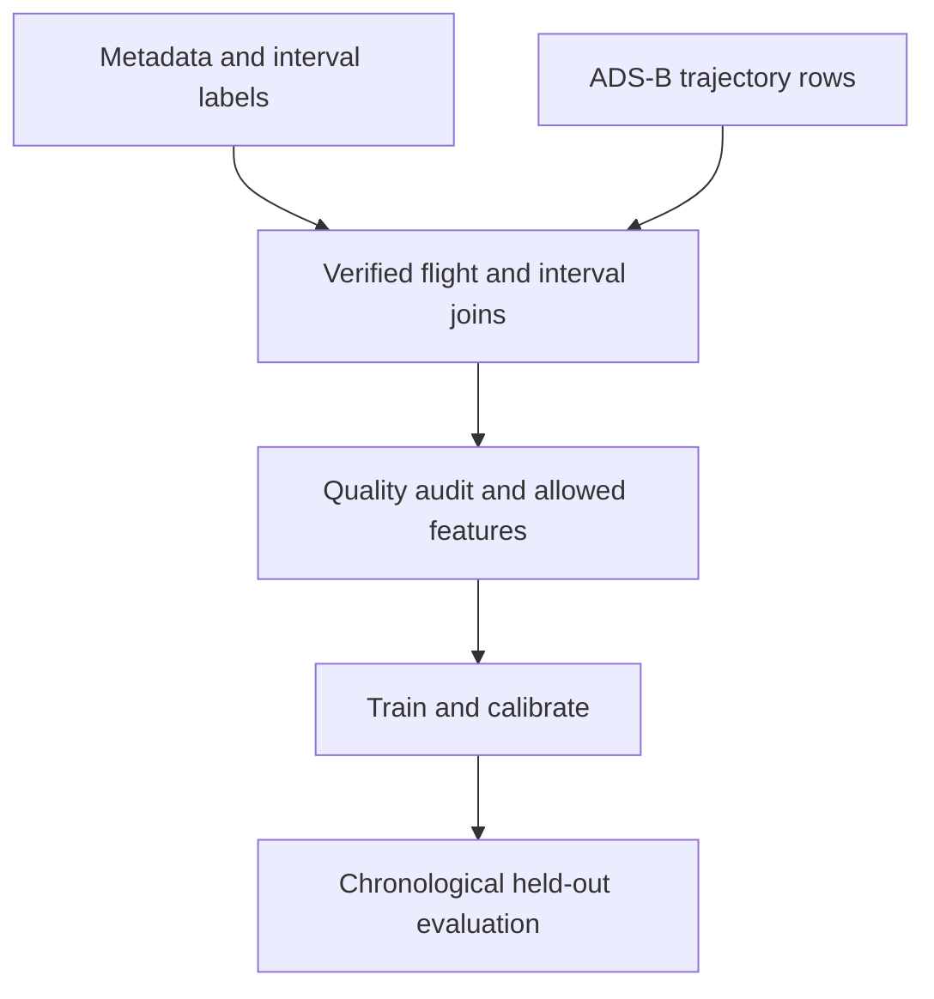

# Phase 1 minor project report draft

> **Revision required before submission:** This 18 October proposal predates the Phase 2 dataset audit. Read the [Phase 2 data acceptance report](phase-2-data-acceptance.md) and revise the abstract, objectives, research gap and methodology around the observation/measurement gate. The current claims about missingness and calibration are retained here as historical draft content.

**Provisional title:** Reliable Aircraft Fuel Burn Estimation from Flight Trajectories  
**Status:** research proposal drafted 18 October 2026. No implementation results are claimed.  
**Student, registration number, section, guide, academic year, and official dates:** [to be entered from current college records].

This Markdown is the **content draft**, not the college's formatted Word submission. Transfer it to the attached `Mini Project Template_Review Phase1.doc`, preserve its front matter and formatting, verify the minimum 12-page requirement after rendering, and obtain guide approval of the title and administrative text. Do not use the 2025 dates found in the prior-year archive.

## Abstract

Estimates of aircraft fuel use support emissions analysis, yet publicly available flight surveillance data do not directly report fuel consumption. Earlier open-data approaches often infer fuel from aircraft performance models or train machine learning on simulated targets. This project studies retrospective fuel consumed during defined flight intervals using the EUROCONTROL PRC 2025 benchmark, which links ADS-B trajectories to fuel-on-board reports sent through ACARS. The proposed system will train a strong tabular ML baseline using ADS-B measurements and aircraft metadata, while excluding fuel telemetry and ACARS-only flight parameters from predictors. Its central question is whether estimates remain accurate and uncertainty intervals remain well calibrated when trajectory observations are missing. Evaluation will separate flights, respect the benchmark's chronological train/ranking/final periods, and report errors, interval coverage and interval width by aircraft group and data completeness. The contribution sought is a reproducible reliability assessment, followed by one justified calibration improvement if the data support it. No fuel accuracy, robustness gain or journal novelty is asserted before the experiments.

# Chapter 1 Introduction

## 1.1 Background

Aircraft fuel use varies with aircraft characteristics, duration, speed, altitude, climb and descent, weather, payload and operational choices. Operators can obtain detailed onboard data, but external researchers often have access only to surveillance trajectories. ADS-B observations describe aircraft movement; an estimator must infer fuel use from those observations and assumptions. An estimate may be useful for retrospective emissions analysis, yet it should communicate when the available evidence is insufficient for a precise value. Physics and aircraft-performance models offer interpretability but depend on aircraft-specific coefficients and unobserved quantities such as mass. Machine learning can capture patterns in labeled examples but can fail when its inputs differ from training data. Both aspects matter when flight trajectories contain gaps [1], [5], [6].

## 1.2 Present context and motivation

The EUROCONTROL PRC 2025 challenge released interval fuel labels derived from ACARS fuel-on-board messages together with OpenSky ADS-B trajectories and aircraft metadata [1]. Its data span different aircraft types and months, enabling an evaluation more meaningful than fitting a model to synthetic fuel labels. The labels still contain measurement and processing uncertainty: reports are sparse, units required inference, and erroneous intervals were screened using a performance model [1]. They are a benchmark for *observed-derived interval fuel burn*, not a perfect reading from every engine.

Recent challenge papers already demonstrate physics-guided gradient boosting and richer weather/performance features [2], [3]. A newly published study investigates missing data, conformal uncertainty and decision reliability, with a small observed subset from this benchmark alongside larger synthetic experiments [4]. Thus, merely using XGBoost, adding a physics formula, plotting a map, or reporting an uncertainty range cannot establish originality. The practical question is whether a transparent estimator limited to surveillance-visible inputs retains reliable predictions across real ADS-B gaps, aircraft groups and later periods. This proposal states the input boundary and evaluation before choosing a complex model.

## 1.3 Problem statement

Given a completed interval identified by its start and end times, aircraft type, and available ADS-B states within that interval, estimate fuel consumed in kilograms. Also produce a prediction interval that reflects uncertainty and evaluate its empirical coverage and width. The study must distinguish (a) naturally sparse trajectories from deliberately removed observations, (b) seen aircraft groups from genuinely held-out types, and (c) average performance from worst-group behaviour.

This task does **not** predict fuel before a flight, optimize a route, diagnose mechanical faults, or rank individual airlines by efficiency. The ACARS report times define the benchmark intervals; a live application would need its own independent interval definition and new validation.

## 1.4 Objectives and expected outcome

The objectives are to: (1) build a documented, leakage-controlled data pipeline; (2) benchmark simple and tabular ML estimators on chronological held-out flights; (3) measure error and uncertainty under natural and simulated coverage loss; (4) compare pooled with quality- or group-aware calibration without claiming guarantees under temporal shift; and (5) present reproducible results and limitations through a small explanatory demo. Success for the academic project means credible evidence and a working implementation, even if a proposed method offers no gain. A journal-ready paper requires a demonstrated, distinct contribution and further review.

## 1.5 Work schedule and report organization

Phase 1 covers literature, objectives and methodology. Phase 2 audits and prepares the released data. Phase 3 establishes baselines. Phase 4 runs missingness, subgroup and calibration experiments. Phase 5 builds the demo and checks reproducibility; Phase 6 completes the report, presentation and paper draft. The current review and final dates must come from the guide; the 2025 examples are historical. Chapter 2 synthesizes relevant studies. Chapter 3 gives measurable objectives and hypotheses. Chapter 4 specifies the proposed system and evaluation. Chapter 5 summarizes the proposal and its decision gates.

# Chapter 2 Literature Review

## 2.1 Data and aircraft fuel estimation

The dataset paper [1] describes how ACARS fuel-on-board reports and ADS-B trajectories were fused. It reports 15,761 flights and 193,275 intervals across 27 aircraft types. Consecutive fuel-on-board differences form the target, while unit checks and quality filters reduce obviously implausible records. This is a major advance for this project because fuel labels are not generated by the model being trained. It does not remove label error, uneven aircraft representation, or missing surveillance coverage.

Grigoriou et al. [2] use physical features, aircraft-performance information and gradient boosting on the same challenge. Their reported accuracy establishes a demanding point-estimation comparison for a rich-input setting, not a performance number that can be transferred unchanged to an ADS-B-only estimator. Kačar and Ćulibrk [3] likewise combine trajectory, meteorological and physically motivated intermediate features. Together these papers rule out a weak novelty claim based on XGBoost plus weather. We will state what information each competing approach requires and will reproduce comparable baselines only when the same inputs are available.

Zhang et al. [5] use trajectory dynamics and a deep-learning framework for aircraft fuel estimation, reinforcing the value of the time structure in surveillance data. Their dataset, target construction and percentage-error measure differ from the PRC benchmark. Jarry et al. [6] investigate generalization to aircraft types absent from training; their work uses modeled fuel-flow targets and a different task. These studies motivate type-specific checks without implying that this project invents trajectory-based DL or aircraft transfer.

## 2.2 Missing observations and predictive uncertainty

Stawiarska [4] directly studies data-quality deterioration and predictive uncertainty, including external validation on 686 intervals from 79 PRC flights. That work means our broad topic is already occupied. The narrower empirical question is whether full-benchmark natural trajectory gaps, a deliberately restricted ADS-B input budget and chronological, aircraft-stratified coverage analysis yield a useful result beyond that study. A close methodological reading and the actual data audit may force a further change in scope.

Conformalized quantile regression [7] provides adaptive prediction intervals under exchangeability assumptions. Zaffran et al. [8] show that good marginal coverage can hide poor coverage for specific missing-feature patterns. Tibshirani et al. [9] study methods under covariate shift with additional assumptions. These works motivate evaluating coverage by gap severity and aircraft group; they do not justify an automatic guarantee when calibration occurs in September and testing in October. We will report measured coverage and the conditions under which theoretical claims would or would not apply.

## 2.3 Synthesis and precise gap

The literature demonstrates strong rich-input fuel estimators [2], [3], trajectory models [5], aircraft-type generalization concerns [6], and missingness-aware uncertainty methods [4], [7]–[9]. A plausible remaining gap is a *reproducible full-benchmark assessment* of an ADS-B-only retrospective estimator with explicit feature provenance, natural and structured trajectory gaps, aircraft-group results and later-period calibration checks. This gap is provisional. We will compare the full methods and experiments in [2]–[4] before asserting that the manuscript makes a new contribution. The [detailed comparison matrix](phase-1-literature-review.md) documents the evidence and distinctions.

# Chapter 3 Objectives

## 3.1 Primary objective

Determine the accuracy and reliability of fuel-burn estimation from ADS-B trajectories for completed intervals using ACARS-derived benchmark labels [1], under an explicit no-fuel-telemetry predictor policy. Reliability means both point error and the empirical frequency with which a prespecified prediction interval contains the reported target.

## 3.2 Specific objectives and testable hypotheses

**Objective A — data validity:** Verify dataset version, archive integrity, joins, unique flight IDs, valid intervals, aircraft distribution and usable ADS-B observations. Record every filter and the remaining sample counts before modeling.

**Objective B — strong baselines:** Fit a type/duration reference and a tabular ML estimator; compare error on untouched later-period flights, including per-flight and per-group summaries. The reported quantity is interval fuel in kg, not kg/hour unless explicitly normalized.

**Objective C — missing-data study:** Define coverage features such as observed-point count, time fraction covered, longest gap, first/last observation distance from interval boundaries and sampling irregularity. Compare naturally sparse cases with random thinning and contiguous blackout simulations. Hypothesis H1 is that explicit coverage features reduce error under sparse observations relative to an otherwise matched model; the null is no improvement.

**Objective D — uncertainty:** Build pooled 90% residual-conformal intervals, then compare quantile- or group-aware variants if calibration sample sizes permit. Hypothesis H2 is that pooled 90% intervals have unequal coverage across data-quality/aircraft groups on the later period. Hypothesis H3 is that a prespecified stratified method can improve the worst-group coverage/width tradeoff. Neither is assumed true.

**Objective E — communication:** Deliver a runnable pipeline, versioned figures, and a demo of estimates, quality flags and uncertainty. Explain failure cases rather than describing outliers as mechanical faults or fuel waste.

## 3.3 Boundaries and target specifications

The target is the benchmark field `fuel_kg` between consecutive ACARS reports, associated with a flight and interval [1]. Predictors may use interval duration, independent aircraft metadata, and ADS-B rows within the completed interval. ACARS-only Mach, true/calibrated airspeed, fuel telemetry, the target, and features computed from future intervals are forbidden. An input-feature audit will document each column's source and earliest availability. If aircraft type is missing or rare, a predefined fallback or exclusion must be reported rather than silently imputing a category.

# Chapter 4 Methodology

## 4.1 Dataset and workflow

The public PRC release includes training (April–August 2025), ranking (September) and final (October) periods [1]. Metadata, interval labels and one trajectory file per flight are joined by flight ID. The working dataset is one row per labeled interval, with aggregate features calculated only from ADS-B observations inside its time bounds. Processing begins with a small stratified subset to confirm resource needs, then scales after successful validation. Raw archives remain outside GitHub; scripts and a data manifest provide reproducibility.

This is an observational prediction study. It cannot establish that changing a flight path would *cause* a particular fuel saving. Label uncertainty and dataset-specific interval selection are recorded as limitations.

## 4.2 Preprocessing and leakage controls

For every interval, verify `end > start`, nonnegative reported burn, plausible duration within the release's documented range, and an unambiguous flight join. Keep a record of duplicate and missing cases. Filter trajectory rows to `source == 'adsb'`; sort by timestamp, remove duplicate timestamps under a documented rule, and never fill a long outage by pretending interpolated points were received. Missing observations may be informative: report them as quality features. Fit imputation, encoding and any scaling on training data only. Review aircraft type, departure/destination and dates for memorization or leakage via repeated routes.

The default comparison uses the released time periods, never a random interval-level split. Training flights fit the model. The ranking period is used for model choice and calibration with a further separation if both operations need the same period. The final period is untouched until choices are frozen. Any experiment with unseen aircraft types uses a separately designed type holdout, not a reinterpretation of ordinary chronological testing.

## 4.3 Baselines and candidate models

A simple reference estimates interval fuel from type-specific typical fuel rate times duration, using only training information and a global fallback for rare types. A tabular model such as histogram gradient boosting or CatBoost uses the same metadata and adds trajectory summaries: altitude, ground speed and vertical-rate statistics, proportions in climb/level/descent, estimated traveled distance from observed points, and observation-quality measures. These require precise units and clearly documented derivation. Baseline ablations will add feature groups one at a time. A sequence model is optional only after its extra complexity is justified by measured errors and compute budget.

For uncertainty, a first baseline applies split conformal calibration to held-out ranking-period residuals from a frozen point model. A second candidate uses quantile regression or CQR [7], with aircraft/quality-aware calibration where support is adequate [8]. Small groups must fall back to broader groups under a predefined rule. Prediction intervals must be nonnegative and reported in kg. The comparison is empirical under time shift; nominal 90% coverage is a target, not an asserted guarantee.

## 4.4 Experimental design and metrics

Primary point metrics are MAE and RMSE in kg per interval. Include overall interval-weighted and flight-macro results, counts and uncertainty estimates computed by flight-level bootstrap where appropriate. Errors are broken down by aircraft group, interval duration, flight phase composition, and observed coverage. Avoid unstable MAPE for small targets. For intervals, report empirical coverage at the prespecified 90% level, average width in kg, subgroup coverage, and the worst adequately supported subgroup. An interval is not useful merely because it is wide enough to include every target.

Natural missingness is analyzed without altering data. Controlled scenarios include random thinning of received ADS-B points and contiguous blackouts at defined interval locations and lengths. Apply masks only to validation/test inputs, preserve the target, and repeat stochastic masks using fixed seeds. A separate experiment can train with matching masks if this is a declared method, but it must be compared fairly. Published results from [2]–[4] are contextual rather than direct leaderboard claims unless the same release, feature budget, split and target are used.

## 4.5 Tools, resources and assumptions

Python, Parquet readers, pandas or Polars, scikit-learn and one gradient-boosting library are sufficient for a first baseline. Matplotlib/Plotly support evaluation figures; Streamlit is optional for the final demo. Versioned configuration and a scriptable run replace manual notebook-only state. The public trajectory archives total about 4.9 GB compressed [1]; storage, extraction cost and memory need verification before full processing. We assume the release and required packages are accessible and that the supplied metadata may be used under its CC BY 4.0 terms. We do **not** assume the observed fuel labels are error-free, that missingness is random, or that conformal exchangeability holds across months.

## 4.6 Decision gates

Phase 2 stops model development until archive checks, target alignment, allowed features and usable counts are recorded. Phase 3 requires a reproducible baseline and locked test protocol. Phase 4 chooses the research result only after examining subgroup sample size, calibration stability and overlap with [4]. If the proposed enhancement fails, report the negative result and the conditions under which the baseline fails. If the gap is already covered, revise the paper question with guide input before drafting a novelty claim.

# Chapter 5 Conclusion

This proposal replaces simulated fuel targets with a documented benchmark of ACARS-derived interval burn, while retaining flight trajectories and an ML model as the core project. It limits prediction inputs to ADS-B and aircraft metadata, states a retrospective inference task, and plans chronological and flight-separated evaluation. Its distinctive question is whether a model's point estimate and stated uncertainty remain useful under actual surveillance gaps and uneven aircraft representation. The literature already contains strong point estimators and a closely overlapping reliability paper [2]–[4]; the final contribution therefore depends on the data audit and matched experiments rather than on an unverified claim of novelty. The immediate next step is to verify the released data and reproduce simple baselines.

# References

[1] J. Sun, E. Spinielli, and M. Strohmeier, “Aircraft Fuel Burn Estimation: The EUROCONTROL PRC 2025 Data Challenge,” *Journal of Open Aviation Science*, vol. 4, no. 3, 2026, doi: [10.59490/joas.2026.8750](https://doi.org/10.59490/joas.2026.8750). Dataset: [10.5281/zenodo.19184662](https://doi.org/10.5281/zenodo.19184662).

[2] Y. Grigoriou *et al.*, “A Physics-Guided Gradient Boosting Framework for Open-Source Aviation Fuel Estimation,” *Journal of Open Aviation Science*, vol. 4, no. 3, 2026, doi: [10.59490/joas.2026.8764](https://doi.org/10.59490/joas.2026.8764).

[3] R. Kačar and D. Ćulibrk, “Fuel Burn Prediction from Open Flight Trajectory and Meteorological Data for the PRC Data Challenge 2025,” *Journal of Open Aviation Science*, vol. 4, no. 3, 2026, doi: [10.59490/joas.2026.8766](https://doi.org/10.59490/joas.2026.8766).

[4] E. M. Stawiarska, “Data Quality and Predictive Reliability in AI-Enabled Aviation Energy Management: Physics-Informed Sensitivity Analysis with Open-Data Validation,” *Energies*, vol. 19, no. 20, art. 4797, 2026, doi: [10.3390/en19204797](https://doi.org/10.3390/en19204797).

[5] L. Zhang, L. Bian, C. Jiang, and L. Wu, “A comprehensive framework for estimating aircraft fuel consumption based on flight trajectories,” *Transportation Research Part E: Logistics and Transportation Review*, vol. 203, art. 104339, 2025, doi: [10.1016/j.tre.2025.104339](https://doi.org/10.1016/j.tre.2025.104339).

[6] G. Jarry, R. Dalmau, P. Very, and J. Sun, “On the generalization properties of deep learning for aircraft fuel flow estimation models,” *Transportation Research Part C: Emerging Technologies*, vol. 176, art. 105143, 2025, doi: [10.1016/j.trc.2025.105143](https://doi.org/10.1016/j.trc.2025.105143).

[7] Y. Romano, E. Patterson, and E. J. Candès, “Conformalized Quantile Regression,” *Advances in Neural Information Processing Systems*, vol. 32, 2019. [Publisher](https://proceedings.neurips.cc/paper/2019/hash/5103c3584b063c431bd1268e9b5e76fb-Abstract.html).

[8] M. Zaffran, A. Dieuleveut, J. Josse, and Y. Romano, “Conformal Prediction with Missing Values,” *Proceedings of the 40th International Conference on Machine Learning*, PMLR 202, pp. 40578–40604, 2023. [Publisher](https://proceedings.mlr.press/v202/zaffran23a.html).

[9] R. J. Tibshirani, R. F. Barber, E. J. Candès, and A. Ramdas, “Conformal Prediction Under Covariate Shift,” *Advances in Neural Information Processing Systems*, vol. 32, 2019. [Publisher](https://proceedings.neurips.cc/paper/2019/hash/8fb21ee7a2207526da55a679f0332de2-Abstract.html).

The detailed comparison matrix is in [the literature review](phase-1-literature-review.md). Verify the final bibliography after transferring this draft into the college template.

# Submission completion notes

Add current cover/inner page, certificate, acknowledgments, contents, optional lists, references and last Project Details page in the college template. Add student/guide facts supplied by the student; do not fabricate signatures, dates, guide feedback or experimental results. Check the rendered Word document against its A4, font, margins, page numbering and 12-page minimum. A slide outline and viva script follow after Phase 2 evidence is available.
